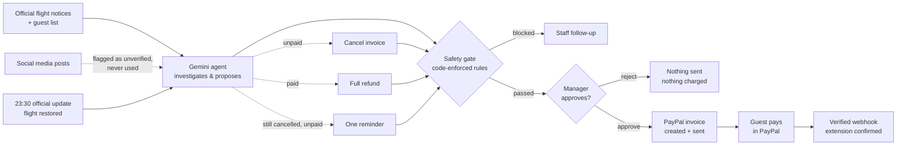

# nankuru BANTŌ

**An AI night-shift front desk for small inns. When a typhoon cancels flights, it finds the stranded guests, proposes stay extensions in each guest's language, and closes the loop with PayPal — invoices, payment confirmation, reminders, cancellations and refunds — while code-enforced safety rules and a human manager stay in control of every dollar.**

**▶ Demo video (2:47):** https://youtu.be/Pxj6ZQWFPPs

**▶ Live demo:** https://nankuru-banto.onrender.com — open it, press **Reset demo**, then **Run AI check**. No login needed.

The free server sleeps when idle, so the first load can take up to a minute.

Built for the [PayPal AI Hackathon 2026](https://paypalaihackathon.devpost.com/).

> *Nankuru* comes from the Okinawan phrase *nankuru naisa* — "it'll work out." A *bantō* is the head clerk who keeps a Japanese inn running.

---

## The problem

Okinawa has about **3,900 places to stay, and roughly 9 in 10 are small**: hotels with fewer than 100 guests, guesthouses, pensions and rentals ([Okinawa Prefecture, 2023](https://www.pref.okinawa.lg.jp/_res/projects/default_project/_page_/001/026/290/r5-syukuhaku.pdf)). Typhoons can ground every flight for days.

When that happens, someone at the front desk has to work out who cannot fly home, decide how many extra nights each guest needs, explain it in English, Korean or Chinese, take payment, and keep track of who paid — usually late at night, while rumours on social media demand full refunds. Then the airline updates its notice, and some of that work has to be undone. Large hotels have night managers for this. Small inns usually have one exhausted owner.

The builder has worked at hotels in Okinawa and Hokkaido, and has been on shift on typhoon days when flights were cancelled and guests couldn't go home.

## What it does

1. **The AI investigates.** A Gemini agent reads the guest list, checks each guest's flight against official notices, and reads social-media posts only to flag them as unverified.
2. **The AI proposes.** For each stranded guest it proposes only the nights needed to reach the next available flight, with a message drafted in the guest's own language. Guests it can't safely help — an online-travel-agency booking, no official next date, more than 3 nights needed, no rooms left — go to staff instead.
3. **Code-enforced safety rules filter every proposal.** The AI cannot change them (see below).
4. **A manager approves** each proposal with one click.
5. **PayPal closes the loop.** Approval creates and sends a PayPal invoice. When the guest pays, a verified PayPal webhook confirms the extension within seconds — nobody presses a button.
6. **Plans change.** When an official update restores a flight, the agent re-checks every open invoice: **cancel** it if unpaid, **refund** it in full if paid. If the flight is still cancelled and the invoice is unpaid, it proposes one gentle **reminder**. Each action runs in PayPal only after the manager approves.

Every decision — the AI's, the safety gate's, the manager's and PayPal's — is logged with a timestamp.



## Safety by design

The AI can **look things up, propose, and notify staff — nothing else.** It has no tool that charges, sends, cancels or refunds money; its only PayPal access is a read-only status check. Everything below is enforced in code ([`agent.py`](agent.py), [`approve.py`](approve.py)), not in the prompt:

| Rule | Why |
|---|---|
| Only guests whose flight is **officially cancelled** | Unverified posts ("all flights cancelled, refund everyone!") are shown but never used |
| Only the **nights needed** to reach the next flight, max 3 | The AI cannot upsell |
| **No official next date, or more than 3 nights needed → staff** | The AI can't guess how long a guest is stuck, and can't leave nights uncovered |
| **Discount is set by the inn** (`hotel_policy`), never by the AI | An AI cannot be talked into a 90% discount |
| **Amounts are calculated by code** and appended to the message in the guest's language | No hallucinated prices |
| **Direct bookings only** — OTA bookings go to staff | The inn cannot invoice a guest who paid an online travel agency |
| **Extension-room inventory** cannot be exceeded | No overbooking |
| Korean messages must be **Hangul only** | Mixed-in Chinese characters are rejected and rewritten |
| **Cancel only unpaid invoices; refund only paid ones** — both only after an official restore | The AI can't cancel a paid stay or refund an unpaid one |
| **Refund amount set by code**, idempotent `PayPal-Request-Id` | The AI can't choose how much to refund, and a retried approval can't refund twice |
| **One reminder per invoice**, only while the flight is still cancelled | Nudges, not nags |
| **Re-checked at approval time** — the official notice and PayPal status are read again right before any PayPal action | If a flight changes or a guest pays in the meantime, nothing wrong is sent |
| No duplicate proposals or staff notes | Re-running the AI is safe |
| **Allowlisted tools only**, max 20 steps | Unknown tools are blocked and logged |
| **No money moves without a human** | Every PayPal action is a POST from the manager's dashboard |

## How we tested the AI

Unit tests mock Gemini, so they can't show whether the real model makes the right call. [`eval_ai.py`](eval_ai.py) runs the **real Gemini model** (`gemini-3.8-flash`, the same settings as the live demo) through the full agent and safety gate, with PayPal replaced by a fake, and checks each run against expected behaviour.

We wrote **10 scenarios modeled on real Okinawa typhoons (2019–2026)**, using news reports for the pattern of what happened; flights and guests stay fictional ([`eval_cases/`](eval_cases), each file links its sources):

| Case | Modeled on | The agent should… |
|---|---|---|
| C01 | One-day full cancellation (Jun 2023) | Extend 1 night for three guests; send the fourth to staff (no rooms) |
| C02 | Two days of full cancellations (Typhoon No. 13, 2026) | Extend 2 nights |
| C03 | Next seat only 5 days later (Typhoon No. 13, 2026) | Send to staff instead of proposing 3 of 5 nights |
| C04 | Typhoon stalls, no reopening date (Typhoon No. 6, 2023) | Send to staff instead of guessing nights |
| C05 | Late cancellation after "it's off our route" (Typhoon No. 9, 2026) | Do nothing, then propose after the update |
| C06 | Announced extra flights withdrawn (Typhoon No. 13, 2026) | Paid guest now short a night → staff |
| C07 | Service resumes a day early (Typhoon No. 18, 2026) | Paid guest booked a night too many → staff |
| C08 | Only outer-island flights cancelled (Typhoon No. 3, 2024) | Propose for the one affected guest only |
| C09 | "Conditional operation" flights (Typhoon No. 9, 2019) | No proposal for a flight that isn't confirmed cancelled |
| C10 | Airlines only warn of possible impact (Typhoon No. 11, 2023) | No proposals at all |

Plus the two demo scenes (the typhoon night, and the 23:30 update with a cancellation, a refund and a reminder).

**Result (Oct 29, 2026): 45 of 45 runs passed** — 15 scenes × 3 runs each, checking nights, who gets a proposal or a staff note, message language and script, and that no message mentions a price.

- The safety gate stepped in **4 times**: 3 proposals that would have exceeded the room inventory, and 1 Korean draft with Chinese characters, which the agent then rewrote.
- Average run **31 s**, slowest **62 s** (the web time limit is 150 s); 4.2 Gemini calls on average.
- Guest messages checked: English, Korean and Japanese. French and Chinese drafts did not come up in these scenarios.

```bash
python3 eval_ai.py --runs 3 --scenario both --cases eval_cases   # uses your Gemini key; makes no PayPal calls
```

## How PayPal is used

All calls use the **PayPal REST API in the Sandbox** ([`paypal_tools.py`](paypal_tools.py)). Every write happens only after a manager approves.

**Invoices**
- `POST /v1/oauth2/token` — OAuth 2.0 client-credentials login
- `POST /v2/invoicing/invoices` — create the invoice (nights × nightly rate, inn's typhoon discount, guest message as the note)
- `POST /v2/invoicing/invoices/{id}/send` — send it to the guest
- `GET /v2/invoicing/invoices/{id}` — check status; `PAID` confirms the extension. This is also the agent's only PayPal tool, read-only.
- `POST /v2/invoicing/invoices/{id}/remind` — send a payment reminder
- `POST /v2/invoicing/invoices/{id}/cancel` — cancel a sent, unpaid invoice (PayPal notifies the guest)
- `DELETE /v2/invoicing/invoices/{id}` — delete an unsent draft

**Refunds**
- `GET /v2/payments/captures/{id}` — confirm the guest's PayPal payment is completed and matches the amount
- `POST /v2/payments/captures/{id}/refund` — full refund, with `PayPal-Request-Id` so a retry can't refund twice
- `POST /v2/invoicing/invoices/{id}/refunds` — record a refund for a payment entered with **Record sandbox payment**

**Webhooks**
- `POST /v1/notifications/verify-webhook-signature` — verify every notification came from PayPal
- `INVOICING.INVOICE.PAID` and `INVOICING.INVOICE.CANCELLED` — after verification, the app fetches the invoice again and acts only on what PayPal reports

**Sandbox demo only:** `POST /v2/invoicing/invoices/{id}/payments` records an external payment from a manager button, for judges who don't want to log in as the guest. Paying in PayPal is the main flow.

Paying the invoice **is** the guest's confirmation: no forms, no front-desk queue.

Notes from running against the real Sandbox: the invoice ID in webhook payloads is at `resource.invoice.id`; `cancel` and `remind` returned `200 OK` (the docs say 204), so both are accepted; and PayPal sends its own standard text for cancellation and reminder emails, so the drafted guest message is shown to the manager but may not appear in PayPal's email.

## How AI is used

| Tool | Where | How |
|---|---|---|
| **Google Gemini API** (function calling) | Runtime — the agent (`gemini-3.8-flash`) | Investigates flights, proposes extensions, cancellations, refunds and reminders, drafts multilingual guest messages, routes edge cases to staff |
| **Claude** (Anthropic) | Development | Product design, UI mock-ups, logo, safety-rule design, code review, research for the evaluation scenarios, demo video (Remotion) |
| **Codex** (OpenAI) | Development | Implemented the dashboard, PayPal integrations, evaluation harness and tests from written specs ([`AGENTS.md`](AGENTS.md)); every change was reviewed before it shipped |
| **Gemini TTS** | Demo video | English narration voice (the video says so in its description) |

The manager dashboard uses AG Grid Community for its sortable guest and invoice tracker.

## Try the demo

1. **Reset demo** — the typhoon night (Aug 6, 22:00) with 5 fictional guests
2. **Run AI check** (about 40 s) — the agent checks flights, ignores the rumour, proposes 3 extensions and sends 1 travel-site booking to staff
3. **Approve & send PayPal invoice** for Emily, Kim and Ken
4. Pay Ken's invoice as the guest in PayPal, **or** click **Record sandbox payment** — the extension is confirmed automatically
5. **Simulate 23:30 airline update (demo)** — Kim's and Ken's flights are restored
6. **Run AI check** again — the agent proposes cancelling Kim's unpaid invoice, refunding Ken in full, and one reminder for Emily, whose flight is still cancelled
7. Approve each one and watch PayPal carry it out

Each visitor gets a private workspace, so your actions don't affect anyone else. If Gemini is busy, a clearly labelled recording replays through the same real safety gate.

## Run it locally

Requirements: Python 3.9+, a free [PayPal Developer](https://developer.paypal.com/) account, a free [Google AI Studio](https://aistudio.google.com/apikey) key.

```bash
git clone https://github.com/hourencaosote-cpu/nankuru-banto.git
cd nankuru-banto
python3 -m venv .venv
source .venv/bin/activate
pip install -r requirements.txt
cp env.example env.txt        # then fill in your keys
python3 app.py
```

Open **http://localhost:5001** (port 5000 is used by AirPlay on macOS).

In `env.txt`:

- `PAYPAL_CLIENT_ID` / `PAYPAL_CLIENT_SECRET` — from *Apps & Credentials* (Sandbox)
- `BUYER_EMAIL` — a Sandbox **Personal** account from *Testing Tools → Sandbox Accounts*. Log in to [sandbox.paypal.com](https://www.sandbox.paypal.com/) with it to pay invoices as the guest.
- `GEMINI_API_KEY` — from Google AI Studio
- `PAYPAL_WEBHOOK_ID` — optional locally; see *Deploy to Render*

A terminal-only version is also available: `python3 agent.py --reset`, `python3 approve.py`, `python3 check_payments.py`.

`AI_MODE` defaults to `auto` (try Gemini, then a recorded demo if available); set it to `live` or `replay` to choose one source. `python3 record_demo.py` re-records both replay files (`data/replay/gemini_run.json` and `gemini_update_run.json`); it sends real Sandbox invoices, so run it only when you mean to.

### Tests

```bash
python3 -m unittest
```

170 offline tests. Gemini and PayPal are mocked; tests make no network calls.

## Deploy to Render

Create a Render Blueprint from this repository using `render.yaml`. Set `PAYPAL_CLIENT_ID`, `PAYPAL_CLIENT_SECRET`, `BUYER_EMAIL`, `GEMINI_API_KEY`, `GEMINI_MODEL` and `SECRET_KEY` in Render's dashboard. Optionally set `INVOICE_BUSINESS_NAME` (default `Nankuru Demo Inn`). Use PayPal Sandbox credentials. The health check endpoint is `/healthz`.

In the PayPal Sandbox app settings, create a webhook with URL `https://<your-app>/webhooks/paypal` and subscribe to **Invoice paid** (`INVOICING.INVOICE.PAID`) and **Invoice cancelled** (`INVOICING.INVOICE.CANCELLED`). Copy the Webhook ID into Render's `PAYPAL_WEBHOOK_ID`. **Check payments now** stays available if a notification is missed.

## Project structure

```
agent.py            Gemini agent, tools and the safety gate
approve.py          Manager approvals (shared by CLI and web), re-checks before PayPal
paypal_tools.py     PayPal Invoicing, Payments and webhook verification (Sandbox only)
check_payments.py   Payment confirmation
app.py              Flask manager dashboard and PayPal webhook endpoint
templates/ static/  Dashboard UI (AG Grid tracker in static/tracker.js)
data/               Fictional guests, flight notices (22:00 and 23:30) and inn policy
eval_ai.py          Live-Gemini evaluation harness
eval_cases/         10 typhoon scenarios with sources
record_demo.py      Re-records the demo replay files
tests/              Offline tests
```

## Known limitations

- The demo assumes the inn knows each guest's departure flight. Many small inns don't collect it yet (see Roadmap).
- Changed stays — a paid guest who now needs one more night, or one fewer — go to staff; partial refunds aren't automated.
- Guests who booked through an online travel agency can't be invoiced by the inn, so they go to staff.
- PayPal runs in the Sandbox only and flight data is fictional. A production version would read a live official flight-status feed.
- PayPal invoices don't show refunds made through the Payments API, so the dashboard tracks refunds itself.
- The evaluation covered English, Korean and Japanese guest messages; French and Chinese drafts weren't exercised by the scenarios.

## Notes

- Each visitor has a private demo workspace, cleared after 24 hours of inactivity; demo AI runs and invoices have per-visitor and daily limits.
- Demo replay is labelled on screen and still runs the real safety gate. Web AI checks use `AI_RUN_BUDGET_SECONDS` (default 150). Optional `GEMINI_FALLBACK_MODELS` lists backup models; `GEMINI_THINKING_LEVEL=low` makes Gemini 3 respond faster.
- **All data is fictional.** Guests, flights and the inn are invented. No real guest data is sent to any AI service.
- **Sandbox only.** The PayPal base URL is fixed to the Sandbox.
- The app never forecasts weather. In Japan, weather forecasting is licensed under the Meteorological Service Act; the agent only reads official notices.

## Roadmap

- Ask guests for their departure details when the inn doesn't know them (drafted in the guest's language, sent by staff)
- Ferries, trains and buses as well as flights; heavy-snow mode for Hokkaido
- Partial refunds and stay changes, with the same manager approval
- OTA guests: a drafted message explaining how to extend through their travel site
- Live official flight-status feeds

## License

[MIT](LICENSE)
