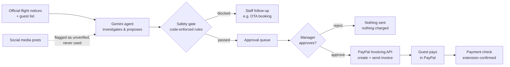

# nankuru BANTŌ

**An AI night-shift front desk for small inns. When a typhoon cancels flights, it finds the stranded guests, proposes stay extensions in each guest's language, and closes the loop with PayPal invoices — while code-enforced safety rules and a human manager stay in control of every dollar.**

Built for the [PayPal AI Hackathon 2026](https://paypalaihackathon.devpost.com/).

> *Nankuru* comes from the Okinawan phrase *nankuru naisa* — "it'll work out." A *bantō* is the head clerk who keeps a Japanese inn running.

---

## The problem

Okinawa has about **3,900 places to stay, and roughly 9 in 10 are small**: hotels with fewer than 100 guests, guesthouses, pensions and rentals ([Okinawa Prefecture, 2023](https://www.pref.okinawa.lg.jp/_res/projects/default_project/_page_/001/026/290/r5-syukuhaku.pdf)). Typhoons regularly ground every flight for days — Typhoon No. 6 in 2023 cancelled **593 flights and affected about 110,000 travellers** in four days.

When that happens, someone at the front desk has to work out who cannot fly home, decide how many extra nights each guest needs, explain it in English, Korean or Chinese, take payment, and keep track of who paid — usually late at night, while rumours on social media demand full refunds. Large hotels have night managers for this. Small inns usually have one exhausted owner.

The builder worked at a large resort hotel in Okinawa and a hotel in Hokkaido, and watched managers stay up past midnight on exactly this work during typhoons and blizzards.

## What it does

1. **The AI investigates.** A Gemini agent reads the guest list, checks each guest's flight against official notices, and reads social-media posts only to flag them as unverified.
2. **The AI proposes.** For each stranded guest it proposes only the nights needed to reach the next available flight, with a message drafted in the guest's own language.
3. **Code-enforced safety rules filter every proposal.** The AI cannot change them (see below).
4. **A manager approves** each proposal with one click on the dashboard.
5. **PayPal closes the loop.** Approval creates and sends a PayPal invoice. When the guest pays, the dashboard confirms the extension.



## Safety by design

The AI can **look things up, propose, and notify staff — nothing else.** It has no tool that charges, sends or refunds money. Everything below is enforced in code ([`agent.py`](agent.py)), not in the prompt:

| Rule | Why |
|---|---|
| Only guests whose flight is **officially cancelled** | Unverified posts ("all flights cancelled, refund everyone!") are shown but never used |
| Only the **nights needed** to reach the next flight, max 3 | The AI cannot upsell |
| **Discount is set by the inn** (`hotel_policy`), never by the AI | An AI cannot be talked into a 90% discount |
| **Amounts are calculated by code** and appended to the message in the guest's language | No hallucinated prices |
| **Direct bookings only** — OTA bookings go to staff | The inn cannot invoice a guest who paid an online travel agency |
| **Extension-room inventory** cannot be exceeded | No overbooking |
| No duplicate proposals or staff notes | Re-running the AI is safe |
| **Allowlisted tools only**, max 20 steps | Unknown tools are blocked and logged |
| **No money moves without a human** | Every approval is a POST from the manager's dashboard |
| Every decision is logged | AI proposals, gate blocks, human approvals and payments, with timestamps |

## How PayPal is used

All calls use the **PayPal REST API in the Sandbox** ([`paypal_tools.py`](paypal_tools.py)):

- `POST /v1/oauth2/token` — OAuth 2.0 client-credentials login
- `POST /v2/invoicing/invoices` — create the invoice (nights × nightly rate, inn's typhoon discount, guest message as the invoice note)
- `POST /v2/invoicing/invoices/{id}/send` — send it to the guest
- `GET /v2/invoicing/invoices/{id}` — check status; `PAID` confirms the extension

Paying the invoice **is** the guest's confirmation: no forms, no front-desk queue.

## How AI is used

| Tool | Where | How |
|---|---|---|
| **Google Gemini API** (function calling) | Runtime — the agent | Investigates flights, proposes extensions, drafts multilingual guest messages, routes edge cases to staff |
| **Claude** (Anthropic) | Development | Product design, UI mock-ups, logo, safety-rule design, code review and testing |
| **Codex** (OpenAI) | Development | Implemented the Flask dashboard and tests from written specs ([`AGENTS.md`](AGENTS.md)) |

## Run it locally

Requirements: Python 3.9+, a free [PayPal Developer](https://developer.paypal.com/) account, a free [Google AI Studio](https://aistudio.google.com/apikey) key.

```bash
git clone https://github.com/hourencaosote-cpu/nankuru-banto.git
cd nankuru-banto
python3 -m venv .venv
source .venv/bin/activate
pip install -r requirements.txt
cp env.example env.txt        # then fill in your keys
python3 app.py
```

Open **http://localhost:5001** (port 5000 is used by AirPlay on macOS).

In `env.txt`:

- `PAYPAL_CLIENT_ID` / `PAYPAL_CLIENT_SECRET` — from *Apps & Credentials* (Sandbox)
- `BUYER_EMAIL` — a Sandbox **Personal** account from *Testing Tools → Sandbox Accounts*. Log in to [sandbox.paypal.com](https://www.sandbox.paypal.com/) with it to pay invoices as the guest.
- `GEMINI_API_KEY` — from Google AI Studio

### Demo walkthrough

1. **Reset demo** — starts the typhoon night (Aug 6, 22:00) with 5 fictional guests
2. **Run AI check** — watch the agent check flights, ignore the rumour, propose 3 extensions and send 1 OTA booking to staff
3. **Approve & send PayPal invoice** on a guest
4. Pay the invoice in the Sandbox Personal account
5. **Check payments** — the extension is confirmed

A terminal-only version is also available: `python3 agent.py --reset`, `python3 approve.py`, `python3 check_payments.py`.

### Tests

```bash
python3 -m unittest
```

Gemini and PayPal are mocked; tests make no network calls.

## Project structure

```
agent.py            Gemini agent, tools and the safety gate
paypal_tools.py     PayPal Invoicing API (Sandbox only)
approve.py          Approval actions (shared by CLI and web)
check_payments.py   Payment confirmation
app.py              Flask manager dashboard
templates/ static/  Dashboard UI
data/               Fictional guests, flights and inn policy
tests/              Offline tests
```

## Notes

- **All data is fictional.** Guests, flights and the inn are invented. No real guest data is sent to any AI service.
- **Sandbox only.** The PayPal base URL is fixed to the Sandbox.
- The app never forecasts weather. In Japan, weather forecasting is licensed under the Meteorological Service Act; the agent only reads official notices.

## Roadmap

- Cancellation and refund flow
- Heavy-snow mode (Hokkaido airports)
- Staff shift check-ins drafted by the AI, approved by the manager
- Live official flight-status feeds

## License

[MIT](LICENSE)
