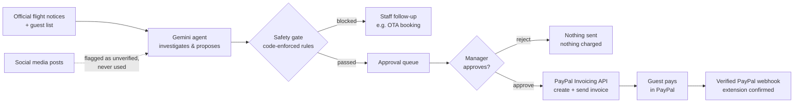

# nankuru BANTŌ

**An AI night-shift front desk for small inns. When a typhoon cancels flights, it finds the stranded guests, proposes stay extensions in each guest's language, and closes the loop with PayPal invoices — while code-enforced safety rules and a human manager stay in control of every dollar.**

**▶ Demo video (2:47):** https://youtu.be/Pxj6ZQWFPPs

**▶ Live demo:** https://nankuru-banto.onrender.com — open it, press **Reset demo**, then **Run AI check**.

The free server sleeps when idle, so the first load can take up to a minute.

Built for the [PayPal AI Hackathon 2026](https://paypalaihackathon.devpost.com/).

> *Nankuru* comes from the Okinawan phrase *nankuru naisa* — "it'll work out." A *bantō* is the head clerk who keeps a Japanese inn running.

---

## The problem

Okinawa has about **3,900 places to stay, and roughly 9 in 10 are small**: hotels with fewer than 100 guests, guesthouses, pensions and rentals ([Okinawa Prefecture, 2023](https://www.pref.okinawa.lg.jp/_res/projects/default_project/_page_/001/026/290/r5-syukuhaku.pdf)). Typhoons can ground every flight for days.

When that happens, someone at the front desk has to work out who cannot fly home, decide how many extra nights each guest needs, explain it in English, Korean or Chinese, take payment, and keep track of who paid — usually late at night, while rumours on social media demand full refunds. Large hotels have night managers for this. Small inns usually have one exhausted owner.

The builder has worked at hotels in Okinawa and Hokkaido, and has been on shift on typhoon days when flights were cancelled and guests couldn't go home.

## What it does

1. **The AI investigates.** A Gemini agent reads the guest list, checks each guest's flight against official notices, and reads social-media posts only to flag them as unverified.
2. **The AI proposes.** For each stranded guest it proposes only the nights needed to reach the next available flight, with a message drafted in the guest's own language.
3. **Code-enforced safety rules filter every proposal.** The AI cannot change them (see below).
4. **A manager approves** each proposal with one click on the dashboard.
5. **PayPal closes the loop.** Approval creates and sends a PayPal invoice. When the guest pays, a PayPal webhook confirms the extension within seconds, without a manager pressing a button.
6. **Plans change.** If an official update restores a guest's flight, the agent proposes cancelling the unpaid invoice. When the manager approves, PayPal cancels it and tells the guest.



## Safety by design

The AI can **look things up, propose, and notify staff — nothing else.** It has no tool that charges, sends or refunds money. Everything below is enforced in code ([`agent.py`](agent.py)), not in the prompt:

| Rule | Why |
|---|---|
| Only guests whose flight is **officially cancelled** | Unverified posts ("all flights cancelled, refund everyone!") are shown but never used |
| Only the **nights needed** to reach the next flight, max 3 | The AI cannot upsell |
| **Discount is set by the inn** (`hotel_policy`), never by the AI | An AI cannot be talked into a 90% discount |
| **Amounts are calculated by code** and appended to the message in the guest's language | No hallucinated prices |
| **Direct bookings only** — OTA bookings go to staff | The inn cannot invoice a guest who paid an online travel agency |
| **Extension-room inventory** cannot be exceeded | No overbooking |
| Cancellations only for unpaid invoices, after an official restore | Paid invoices are never touched by the agent; refunds stay with staff |
| No duplicate proposals or staff notes | Re-running the AI is safe |
| **Allowlisted tools only**, max 20 steps | Unknown tools are blocked and logged |
| **No money moves without a human** | Every approval is a POST from the manager's dashboard |
| Every decision is logged | AI proposals, gate blocks, human approvals and payments, with timestamps |

## How PayPal is used

All calls use the **PayPal REST API in the Sandbox** ([`paypal_tools.py`](paypal_tools.py)):

- `POST /v1/oauth2/token` — OAuth 2.0 client-credentials login
- `POST /v2/invoicing/invoices` — create the invoice (nights × nightly rate, inn's typhoon discount, guest message as the invoice note)
- `POST /v2/invoicing/invoices/{id}/send` — send it to the guest
- `POST /v2/invoicing/invoices/{id}/cancel` — cancel a sent, unpaid invoice after manager approval and notify the guest
- `DELETE /v2/invoicing/invoices/{id}` — delete an unsent invoice draft after manager approval
- `POST /v2/invoicing/invoices/{id}/payments` — **Sandbox demo only:** a manager-pressed button that records an external payment, for judges who don't want to log in as the guest. The guest-pays-in-PayPal path is the primary flow.
- `GET /v2/invoicing/invoices/{id}` — check status; `PAID` confirms the extension
- `POST /v1/notifications/verify-webhook-signature` — verify that a payment notification came from PayPal
- `INVOICING.INVOICE.PAID` webhook — after verification, fetch the invoice with `GET /v2/invoicing/invoices/{id}` and confirm the extension only when PayPal reports it paid
- `INVOICING.INVOICE.CANCELLED` webhook — after verification, fetch the invoice and reflect PayPal's confirmed cancellation

PayPal's current cancellation API accepts `subject` and `note` but says it uses system-defined email text instead of those values. The manager sees the drafted guest message, while PayPal sends its standard cancellation notice. A localized explanation would need a separate staff communication step.

Paying the invoice **is** the guest's confirmation: no forms, no front-desk queue.

## How AI is used

| Tool | Where | How |
|---|---|---|
| **Google Gemini API** (function calling) | Runtime — the agent (`gemini-3.8-flash`) | Investigates flights, proposes extensions, drafts multilingual guest messages, routes edge cases to staff |
| **Claude** (Anthropic) | Development | Product design, UI mock-ups, logo, safety-rule design, code review and testing, demo video (Remotion) |
| **Gemini TTS** | Demo video | English narration voice (the video says so in its description) |
| **Codex** (OpenAI) | Development | Implemented the Flask dashboard and tests from written specs ([`AGENTS.md`](AGENTS.md)) |

The manager dashboard uses AG Grid Community for its sortable guest and invoice tracker.

## Run it locally

Requirements: Python 3.9+, a free [PayPal Developer](https://developer.paypal.com/) account, a free [Google AI Studio](https://aistudio.google.com/apikey) key.

```bash
git clone https://github.com/hourencaosote-cpu/nankuru-banto.git
cd nankuru-banto
python3 -m venv .venv
source .venv/bin/activate
pip install -r requirements.txt
cp env.example env.txt        # then fill in your keys
python3 app.py
```

Open **http://localhost:5001** (port 5000 is used by AirPlay on macOS).

In `env.txt`:

- `PAYPAL_CLIENT_ID` / `PAYPAL_CLIENT_SECRET` — from *Apps & Credentials* (Sandbox)
- `BUYER_EMAIL` — a Sandbox **Personal** account from *Testing Tools → Sandbox Accounts*. Log in to [sandbox.paypal.com](https://www.sandbox.paypal.com/) with it to pay invoices as the guest.
- `GEMINI_API_KEY` — from Google AI Studio

### Demo walkthrough

1. **Reset demo** — starts the typhoon night (Aug 6, 22:00) with 5 fictional guests
2. **Run AI check** — watch the agent check flights, ignore the rumour, propose 3 extensions and send 1 OTA booking to staff
3. **Approve & send PayPal invoice** on a guest
4. Pay as the guest in the Sandbox Personal account, **or** click **Record sandbox payment**
5. The extension is confirmed automatically after the PayPal webhook; **Check payments now** is available if the notification was missed

To show a restored flight, **Approve & send PayPal invoice** for Kim Minji, then click **Simulate 23:30 airline update (demo)** → **Run AI check** → **Approve & cancel PayPal invoice**. PayPal is checked again immediately before cancellation; an already paid invoice stays paid.

A terminal-only version is also available: `python3 agent.py --reset`, `python3 approve.py`, `python3 check_payments.py`.

`AI_MODE` defaults to `auto` (try Gemini, then a recorded demo if available); set it to `live` or `replay` to choose one source. After a successful live run, `python3 agent.py --reset --record` saves Gemini responses in `data/replay/gemini_run.json` for demo replay.

The updated notice uses a separate optional replay file, `data/replay/gemini_update_run.json`. A local operator can create it with `python3 record_demo.py`; this helper resets the CLI demo state and sends a real Sandbox invoice, so run it only when ready to record the two scenarios.

### Tests

```bash
python3 -m unittest
```

Gemini and PayPal are mocked; tests make no network calls.

## Deploy to Render

Create a Render Blueprint from this repository using `render.yaml`. Set the environment variables `PAYPAL_CLIENT_ID`, `PAYPAL_CLIENT_SECRET`, `BUYER_EMAIL`, `GEMINI_API_KEY`, `GEMINI_MODEL`, and `SECRET_KEY` in Render's dashboard. Optionally set `INVOICE_BUSINESS_NAME` for the invoice sender; otherwise it is `Nankuru Demo Inn`. Use PayPal Sandbox credentials. The health check endpoint is `/healthz`.

In the PayPal Sandbox app settings, create a webhook with URL `https://<your-app>/webhooks/paypal` and subscribe to **Invoice paid** (`INVOICING.INVOICE.PAID`) and **Invoice cancelled** (`INVOICING.INVOICE.CANCELLED`). Copy the displayed Webhook ID into Render's `PAYPAL_WEBHOOK_ID` environment variable. The dashboard checks for payment updates automatically; **Check payments now** remains available if a notification was missed.

## Project structure

```
agent.py            Gemini agent, tools and the safety gate
paypal_tools.py     PayPal Invoicing API (Sandbox only)
approve.py          Approval actions (shared by CLI and web)
check_payments.py   Payment confirmation
app.py              Flask manager dashboard
templates/ static/  Dashboard UI
static/tracker.js   Guest and invoice tracker grid
data/               Fictional guests, flights and inn policy
tests/              Offline tests
```

## Known limitations

- The demo assumes the inn knows each guest's departure flight. Many small inns don't collect it yet — next step: the agent drafts a message asking the guest for their flight (see Roadmap).
- Guests who booked through an online travel agency can't be invoiced by the inn, so the agent routes them to staff instead of charging them.
- PayPal runs in the Sandbox only; flight data is fictional. A production version would read a live official flight-status feed.
- The free hosting plan sleeps when idle and keeps demo data in a private per-visitor workspace that resets after 24 hours.

## Notes

- `GEMINI_THINKING_LEVEL=low` makes Gemini 3 respond faster.
- Each visitor has a private demo workspace, cleared after 24 hours of inactivity; demo AI runs and invoice creation have per-visitor and daily limits.
- Demo replay is labeled on screen and still runs the real safety gate; invoices require manager approval. Web AI checks use `AI_RUN_BUDGET_SECONDS` (default 150); CLI recording has no run deadline. Optional `GEMINI_FALLBACK_MODELS` lists backup models separated by commas.
- **All data is fictional.** Guests, flights and the inn are invented. No real guest data is sent to any AI service.
- **Sandbox only.** The PayPal base URL is fixed to the Sandbox.
- The app never forecasts weather. In Japan, weather forecasting is licensed under the Meteorological Service Act; the agent only reads official notices.

## Roadmap

- Ask guests for their departure flight when the inn doesn't know it (drafted in the guest's language, sent by staff)
- OTA guests: a drafted message explaining how to extend through their travel site
- Heavy-snow mode (Hokkaido airports)
- Refunds for already-paid extensions
- Live official flight-status feeds

## License

[MIT](LICENSE)
